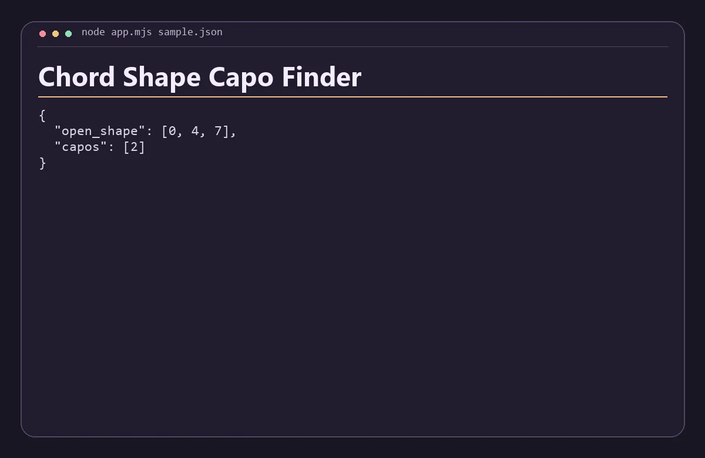

# Chord Shape Capo Finder

Find capo positions where a playable fingering produces exactly the requested set of pitch classes.



## Run

Install Node.js 22 or newer. Run these commands from the repository root.

```sh
node app.mjs sample.json
```

Replace `sample.json` with a JSON file following the same structure. The app prints a JSON report to standard output.

Tuning and target are pitch classes, where C is 0. Enter a fret for each string, relative to the capo, or null to mute it. Doublings and inversions are equivalent. The search includes capo zero.

## Verify

Run `python check.py` with Python 3.11 or newer after the build step when applicable. The check verifies the bundled scenario and confirms that an invalid input returns an error.
